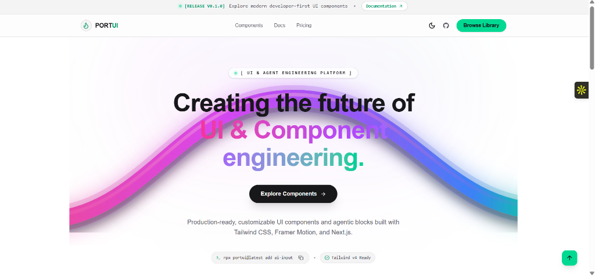

<div align="center">

  <!-- Header Banner -->
  <a href="https://portui-demo.vercel.app">
    
  </a>

  <br />

  <!-- Animated Release Badge & Shields -->
  <p align="center">
    <a href="https://github.com/Callme-VR/PORTUI/releases">
      
    </a>
    <a href="https://nextjs.org">
      
    </a>
    <a href="https://react.dev">
      
    </a>
    <a href="https://tailwindcss.com">
      
    </a>
    <a href="https://motion.dev">
      
    </a>
    <a href="https://www.typescriptlang.org">
      
    </a>
    <a href="https://github.com/Callme-VR/PORTUI/blob/main/LICENSE">
      
    </a>
  </p>

  <h3>⚡ Crafting the future of UI & Component engineering ⚡</h3>

  <p align="center">
    Production-ready, customizable UI primitives and agentic blocks built with Tailwind CSS v4, Framer Motion, and Next.js 15. Cleanly structured with zero bloat.
  </p>

  <p align="center">
    <a href="https://portui-demo.vercel.app"><b>Explore Live Components »</b></a>
    &nbsp;•&nbsp;
    <a href="https://portui-demo.vercel.app/docs"><b>Read Documentation »</b></a>
    &nbsp;•&nbsp;
    <a href="https://github.com/Callme-VR/PORTUI/issues"><b>Report Bug »</b></a>
  </p>

</div>

---

<div align="center">
  
</div>

---

## 🚀 Key Features

<table>
  <tr>
    <td width="50%">
      <h3>🎨 50+ Modern Components</h3>
      <p>Interactive cards, magnetic buttons, AI chat inputs, form controls, profile badges, and status alert blocks ready for production.</p>
    </td>
    <td width="50%">
      <h3>⚡ Powered by Motion</h3>
      <p>Fluid micro-interactions and high-performance physics-based spring animations driven by Framer Motion & Motion One.</p>
    </td>
  </tr>
  <tr>
    <td width="50%">
      <h3>💻 CLI Code Distribution</h3>
      <p>Copy-paste directly or run <code>npx portui@latest add &lt;component&gt;</code> to instantly scaffold components into your repository.</p>
    </td>
    <td width="50%">
      <h3>🎯 Tailwind CSS v4 Ready</h3>
      <p>Engineered for the latest Tailwind v4 engine using native CSS variables and dark-mode first design tokens.</p>
    </td>
  </tr>
</table>

---

## 🛠️ Tech Stack & Ecosystem

<div align="center">
  <br />
  
  <br /><br />
</div>

| Technology | Role | Description |
| :--- | :--- | :--- |
|  **Next.js 15** | Framework | App Router, Server Components & React 19 SSR |
|  **React 19** | Core | Latest React standard with concurrent features |
|  **Tailwind CSS v4** | Styling | Ultra-fast JIT styling with theme variables |
|  **Framer Motion** | Animations | Layout animations, micro-interactions & spring physics |
|  **TypeScript** | Type Safety | Strict end-to-end typing for all component props |
| 🛡️ **Radix Primitives** | Accessibility | Unstyled, accessible UI building blocks |
| 📦 **shadcn/ui** | Design System | Component architecture inspiration & UI base |

---

## 📦 Installation & Setup

### 1. Clone the Repository
```bash
git clone https://github.com/Callme-VR/PORTUI.git
cd PORTUI
```

### 2. Install Dependencies
```bash
npm install
# or
pnpm install
# or
yarn install
```

### 3. Run Development Server
```bash
npm run dev
```
Open [http://localhost:3000](http://localhost:3000) in your browser to view the interactive component library.

### 4. Build for Production
```bash
npm run build
npm run start
```

---

## 📂 Project Structure

```
PORTUI/
├── app/                  # Next.js 15 App Router & layout
│   ├── (root)/           # Main landing page & hero showcases
│   ├── docs/             # Documentation pages (Fumadocs)
│   └── preview/          # Component live preview sandbox
├── components/           # Component library
│   ├── landing/          # Hero, tech stack badges & interactive features
│   ├── layout/           # Header, Footer, and App Shells
│   ├── portui/           # Main component primitives (ai-input, card, button, etc.)
│   └── ui/               # Base UI primitives
├── config/               # Site metadata & navigation links
├── content/              # MDX documentation content
├── public/               # Static assets & component registry JSONs
├── registry/             # Registry schemas & CLI manifests
└── DESIGN.md             # Design system specifications & token mappings
```

---

## ⚡ Component CLI Usage

Install any component directly into your workspace:

```bash
# Add AI Chat Input component
npx portui@latest add ai-input-03

# Add Interactive Card component
npx portui@latest add card-08
```

---

## 🤝 Contributing

Contributions are always welcome! Whether you are fixing a bug, improving documentation, or building a new UI component:

1. Fork the Project
2. Create your Feature Branch (`git checkout -b feature/AmazingFeature`)
3. Commit your Changes (`git commit -m 'Add some AmazingFeature'`)
4. Push to the Branch (`git checkout -b feature/AmazingFeature`)
5. Open a Pull Request

---

## 📄 License

Distributed under the **MIT License**. See [`LICENSE`](LICENSE) for more information.

<div align="center">
  <br />
  <p>Built with ❤️ by <b>Callme-VR</b> and the Open Source Community</p>
  <a href="https://github.com/Callme-VR/PORTUI">
    
  </a>
</div>
